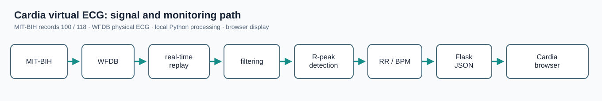
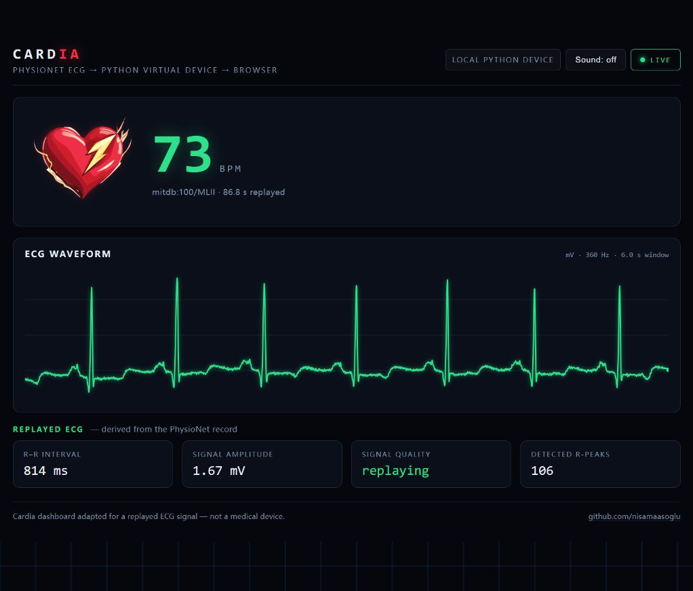
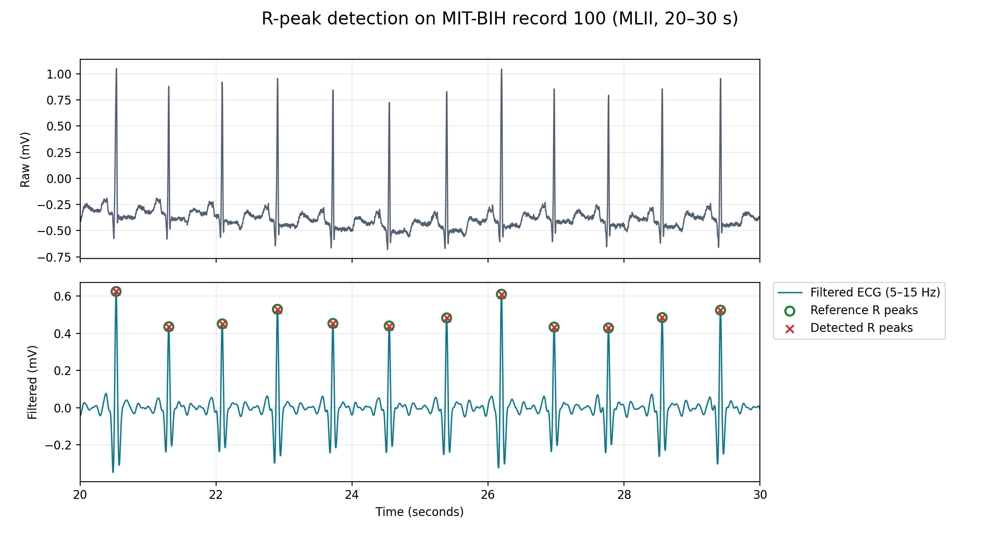

# Virtual ECG acquisition and monitoring with Cardia

This biomedical sensing and instrumentation **course project** extends [Cardia](https://github.com/nisamaasoglu/Cardia) into a hardware-free virtual ECG acquisition and monitoring system. Recorded MIT-BIH ECG is replayed in real time, processed in Python, and shown in a browser. The project includes annotation-based quantitative validation. It is an educational prototype, **not a medical device**.

## Base system and project changes

Cardia by Nisa Maaşoğlu originally uses an AD8232 sensor, Arduino A0 sampling at 500 Hz, Arduino R-peak/RR/BPM processing, a 125 Hz waveform buffer, HTTP JSON, and browser polling at 4 Hz. Its browser demo creates a synthetic waveform and supplies its own BPM. The original firmware remains in `firmware/cardia_ecg/` for attribution; the virtual device does not run it.

This project adds a Python WFDB reader, paced replay, 5–15 Hz band-pass filtering, one Pan–Tompkins 1985 R-peak detector with R-maximum localization, RR/BPM calculation, a Flask JSON endpoint, and annotation-based evaluation. The Cardia page now shows the replay source, physical mV units, signal measurements, and completion state.



**Final pipeline:** MIT-BIH → WFDB → real-time replay → filtering → R-peak detection → RR/BPM → Flask JSON → Cardia browser. The live filter is causal and stateful; offline evaluation uses zero-phase filtering.

## Dataset and installation

Core evaluation uses 120 seconds each of MIT-BIH Arrhythmia Database records **100** and **118**, both MLII at 360 Hz. WFDB reads the records from PhysioNet on demand, so the first run needs network access. Raw data is not packaged in this repository. A local WFDB directory can be supplied with `--source PATH_TO_WFDB_DIRECTORY`. See [data/README.md](data/README.md).

Use Python 3.13 in a virtual environment, from the project root:

```bash
python -m venv .venv
# Activate .venv using your shell's normal activation command.
python -m pip install -r requirements.txt
```

## Run the monitor

```bash
python scripts/run_virtual_device.py --record 100 --speed 1
```

Open <http://127.0.0.1:5000/>. The default replay lasts 120 signal seconds. The dashboard then shows **Completed** and holds its final snapshot; stop the server with Ctrl+C. `--duration 30` shortens a run, and `--speed 0` processes the same chunks without waiting.

`GET /api/ecg` returns the current snapshot. `wave`, `raw`, and `latest_value` retain WFDB physical units; `ibi` is seconds and the browser displays milliseconds. `bpm` can be `null` before a valid interval or after the beat signal becomes stale. `fs` and `display_fs` are in Hz. The page and API share one local Flask server; polling does not reprocess the record.

## Reproduce evaluation

```bash
python -m pytest -q tests
python scripts/run_offline_baseline.py
python scripts/run_evaluation.py
```

The first script refreshes `results/figures/rpeak_overlay_record100.png`; the second writes `results/metrics/core_evaluation.csv`. Both use records 100 and 118. For the optional completed NSTDB check, run `python scripts/run_noise_robustness.py`; it writes `results/metrics/noise_robustness.csv` and `results/figures/f1_vs_noise.png`.

## Results

Offline, 120 seconds per record. A detected peak matches a reference beat within ±100 ms, one to one. Sensitivity, PPV, and F1 are fractions; HR MAE is in BPM.

| Record | TP | FP | FN | Sensitivity | PPV | F1 | HR MAE |
|---|---:|---:|---:|---:|---:|---:|---:|
| 100 | 147 | 0 | 1 | 0.9932 | 1.0000 | 0.9966 | 0.025 |
| 118 | 147 | 0 | 0 | 1.0000 | 1.0000 | 1.0000 | 0.103 |

Full-precision values are in [core_evaluation.csv](results/metrics/core_evaluation.csv). The dashboard image is an actual Phase 4 browser capture.





The optional 300–420 s NSTDB test on record 118 measured F1 of 1.0000 (clean), 1.0000 (18 dB), 0.7288 (6 dB), and 0.5170 (0 dB). See [the noise plot](results/figures/f1_vs_noise.png) and [results notes](docs/results_notes.md).

## Limits and attribution

The core table is **offline** evaluation on two records and one lead; it does not establish clinical performance or generalization. The corrected no-sleep streaming path produced F1 1.0000 on record 100 and 0.9966 on record 118. Record 118's final reference beat falls within the 0.5 s commit margin at the end of the replay and remains uncommitted. Detection drops with heavy electrode-motion noise. The simple `quality` field indicates samples received, not clinical signal quality.

Cardia's original material is credited in [THIRD_PARTY_NOTICES.md](THIRD_PARTY_NOTICES.md); its [MIT license](LICENSE) remains in the repository. See [methods notes](docs/methods_notes.md), [results notes](docs/results_notes.md), and [project status](PROJECT_STATUS.md).
